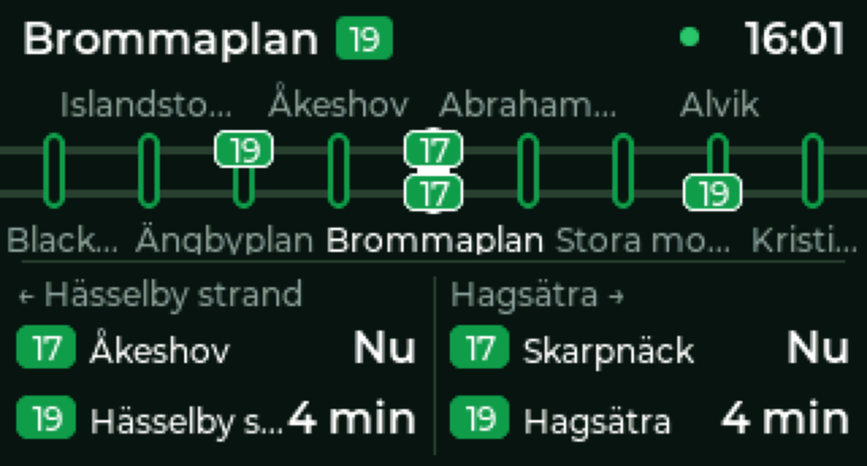
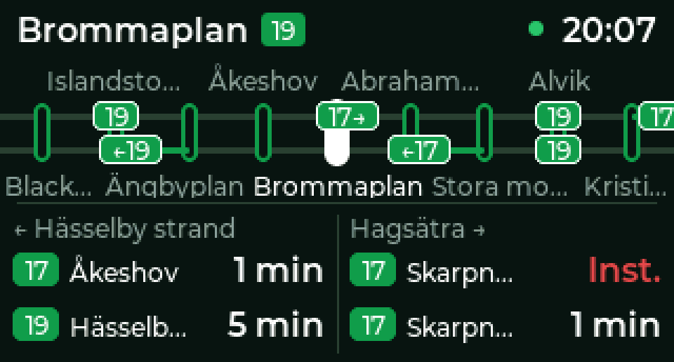
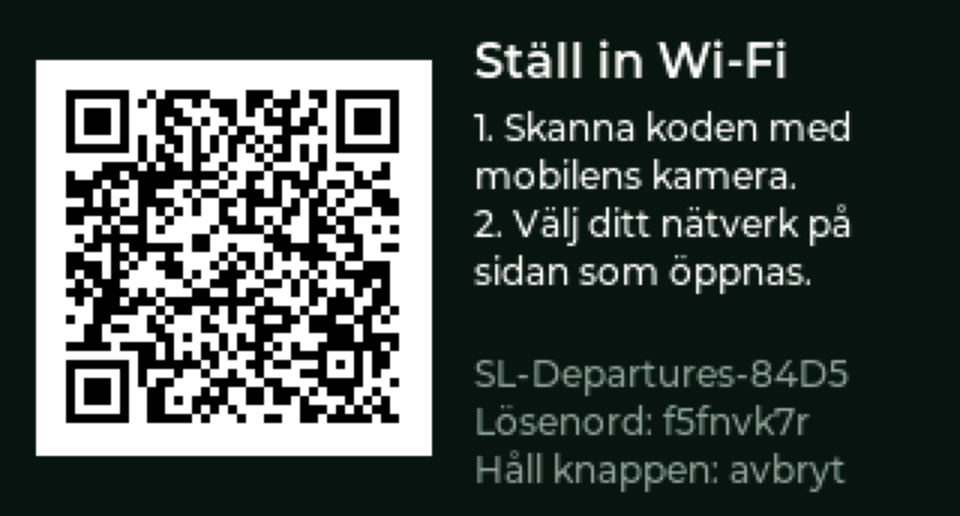

# SL Departures

Live Stockholm metro departures and train positions on a
[Waveshare ESP32-C6-LCD-1.47](https://www.waveshare.com/esp32-c6-lcd-1.47.htm).
Made by Robert Dahlborg.



**Install from your browser:** https://rdahlborg.github.io/sl-departures

## Features

- Every station on the green, red and blue lines (10, 11, 13, 14, 17, 18, 19).
- Line map with four stations each side. Trains are placed from live data and
  glide along the track between updates, in towards your station and on out
  the other side; an arrow and a trail mark trains on their way, and a
  blinking outline marks a train at the platform.
- The next two departures in each direction, with countdowns and cancellations.
- Choose line and station with the BOOT button or from your phone. Your choice
  is remembered.
- Set up Wi-Fi from the web installer or from your phone with a QR code.
- Updates itself over Wi-Fi from the GitHub releases, with automatic rollback.
- Fetches the station list from SL, so new stations show up by themselves.

## Getting started

1. Connect the board to a computer with a USB-C cable that carries data, and
   open the [installer](https://rdahlborg.github.io/sl-departures) in Chrome or
   Edge.
2. Click **Install on your board**, pick the port, and install. Choose erase
   for a first install.
3. Set up Wi-Fi in one of two ways:
   - **In the installer:** enter your network and password when it asks, then
     click **Visit device** to choose the line and station.
   - **From your phone:** close the installer's Wi-Fi dialog. The board shows
     a QR code (see [Wi-Fi setup from a phone](#wi-fi-setup-from-a-phone)).

On first start the board fetches the station list from SL, which takes about
10 seconds once it is online. It starts on Brommaplan on the green line until
you pick another station.

## Using the button

Everything is done with the **BOOT** button. RESET just restarts the board.

| Where | Press | Double press | Hold |
|---|---|---|---|
| Departure board | next station | previous station | open the line list |
| Line list | next entry | previous entry | select |
| Station list | next station | previous station | select |
| Phone QR code | close | close | close |
| Wi-Fi setup | | | cancel |

The line list has the three lines followed by **Mobil…** (station and Wi-Fi
from a phone) and **Om / Uppdatera…** (version, address and updates). The lists close by themselves after 30
seconds without a press.

## Settings from a phone



Pick **Mobil…** in the line list. The board shows a QR code for its settings
page. Scan it with a phone on the same Wi-Fi and choose the line and station.
The board switches at once and closes the code.

The same page lists the saved Wi-Fi networks, with **Glöm** to forget one and
**Lägg till nätverk** to add one. A network added here isn't tried right away,
since that would take the board off the network the phone is on. The board
switches to it when the current network is lost, and only then finds out
whether the password is right.

If the board has no Wi-Fi, **Mobil…** starts the setup hotspot instead (see
below).

The page is at `http://<board address>/`, and also at
`http://sl-departures-xxxx.local/`, where `xxxx` matches the setup hotspot's
name. In the web installer, connecting to a board that has Wi-Fi offers
**Visit device**, which opens the same page.

Anyone on your network can open this page, change the station, and add or
forget Wi-Fi networks.

## Wi-Fi setup from a phone



On first boot, or from **Mobil…** when the board is offline, it starts a
hotspot and shows a QR code:

1. Scan the code with the phone camera to join the hotspot. Its password is
   random each time and is included in the code.
2. A setup page opens. If it doesn't, the screen shows a second code for
   `http://192.168.4.1`. Pick your network, enter the password, and choose
   the line and station.
3. The board shows whether it connected and closes the hotspot. A network
   is only saved once the board has connected to it.

The board remembers up to 5 networks, for example your home Wi-Fi and a phone
hotspot. When it loses its connection it joins the strongest saved network in
range, skipping for a while any network that keeps failing, such as one with a
wrong password. Adding a sixth forgets the one used longest ago.

If setup was opened from the menu and nobody joins, the hotspot closes after
10 minutes.

## Updates

The board checks for a new release every night between 03:00 and 04:00 and
installs it over Wi-Fi, keeping your Wi-Fi and station. To check right away,
open **Om / Uppdatera…** in the line list and hold the button. The version is
shown there and on the start screen.

A new version must fetch departures within 10 minutes of starting, otherwise
the board goes back to the previous version by itself.

Boards installed before v1.1.0 need one update through the web installer to
get the flash layout that updates over Wi-Fi use.

## Troubleshooting

- **The installer's port list is empty, or *Visit device* says the site can't
  be reached (`ERR_ADDRESS_UNREACHABLE`) on a Mac:** allow Chrome under System
  Settings → Privacy & Security → **Local Network**, then quit and reopen
  Chrome.
- **The installer says the port is busy:** another tab or program has the
  board open. Close other installer tabs or unplug and replug the board.
- **The setup page doesn't open after joining the hotspot:** scan the second
  QR code on the screen, or open `http://192.168.4.1` in the phone's browser.
- **The clock shows `--:--` or the dot next to it is orange or red:** red means
  no Wi-Fi, orange means the departure data is more than 90 seconds old.
- **The start screen stays on "Hämtar…":** the board needs internet access
  to fetch the station list the first time. It retries every 30 seconds.

## How trains are placed

SL has no public vehicle positions for the metro. Every departure from the
[SL Transport API](https://www.trafiklab.se/api/other-apis/sl/transport/) does
carry a journey ID shared across stations, though. So the board also fetches up
to five stations on each side of yours. For a train on its way in, the
furthest one that still lists it is where it stops next. The same answers list
trains going the other way, which have already passed your station; for those,
the nearest station listing them is their next stop. Its expected arrival there, and the time
between stations, place it along the track. The API needs no key. Your station
and the nearest one on each side are fetched every 10 seconds, the stations
further out every 30 seconds, about one request every two seconds in all.

Where lines split, the map follows one branch. Trains from the other branch
appear in the departure list and join the map where the branches meet.

## Where the station list comes from

The firmware only knows which lines exist and their end stations. On first
start, it asks [SL's journey planner](https://www.trafiklab.se/api/other-apis/sl/journey-planner-2/)
for a metro-only trip along each line at midday on a weekday, which lists
every station in order. Each station is then looked up in the planner's stop
finder to get the site ID that the departures API uses. That is about 100
requests, done once; the list is kept in flash and refreshed monthly.

## Building

Needs [ESP-IDF v6.1](https://docs.espressif.com/projects/esp-idf/en/v6.1/esp32c6/get-started/).

```sh
idf.py set-target esp32c6
idf.py -p PORT flash monitor
```

Then set up Wi-Fi from the web installer or a phone. For development builds you
can instead create `secrets.defaults`. It is git-ignored and only used when no
network has been saved:

```
CONFIG_WIFI_SSID="my-network"
CONFIG_WIFI_PASSWORD="secret"
```

Other options (timezone, poll interval, screen rotation) are under
*SL Departures Configuration* in `idf.py menuconfig`.

Pushing to `main` makes GitHub Actions build the firmware and publish the
installer page. Pushing a `v*` tag creates a release with two files:
`sl-departures.bin`, which boards download to update themselves, and a merged
`firmware.bin` for `esptool write-flash 0 firmware.bin` (this replaces saved
Wi-Fi and station). After tagging, run the workflow on `main` once more so the
installer page shows the new version.

### Layout

| Path | |
|---|---|
| `main/sl_api.c` | Polls the API, works out train positions |
| `main/ui.c` | LVGL screen: header, line map, departures, lists, QR screens |
| `main/controls.c` | BOOT button gestures, saved station |
| `main/board.c` | Display, Wi-Fi, mDNS name, time sync |
| `main/wifi_setup.c` | Phone setup: hotspot, captive portal DNS, connecting |
| `main/web.c` | Web pages: Wi-Fi setup portal, line and station settings |
| `main/improv.c`, `main/serial.c` | Improv Wi-Fi for the web installer, debug keys |
| `main/screenshot.c` | Screenshots over USB serial |
| `main/metro_data.c` | Station list: fetched from SL, kept in flash |
| `main/json_stream.c` | Streaming JSON reader for large API responses |
| `main/ota.c` | Updates over Wi-Fi, rollback check |
| `main/fonts/` | Montserrat with Swedish letters (generated) |
| `components/dns_server` | Captive portal DNS, from the ESP-IDF examples (CC0) |
| `tools/` | Font generator, screenshot grabber |
| `site/` | Web installer page |

### Debugging over USB serial

`python tools/screenshot.py PORT out.png` saves the screen as a PNG. Sending
`n`, `p` or `h` simulates a press, double press or hold of the button.

### Regenerating fonts

```sh
tools/gen_fonts.sh DIR   # DIR holds Montserrat-Medium, -SemiBold and -Bold .ttf
```

## Credits

- Data from [Trafiklab.se](https://www.trafiklab.se/) (SL Transport API).
  Not affiliated with SL or Trafiklab.
- [Montserrat](https://github.com/JulietaUla/Montserrat) font, SIL Open Font
  License 1.1 (`main/fonts/OFL.txt`).
- [LVGL](https://lvgl.io/), [ESP Web Tools](https://esphome.github.io/esp-web-tools/),
  [Improv Wi-Fi](https://www.improv-wifi.com/), and Espressif's button, mDNS
  and LVGL port components.

## Author

Robert Dahlborg ([@rdahlborg](https://github.com/rdahlborg)). Issues and pull
requests are welcome.

## License

MIT, see [LICENSE](LICENSE).
